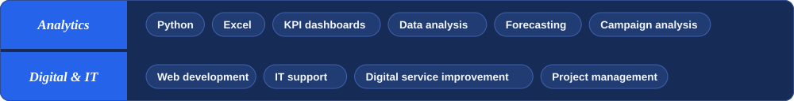
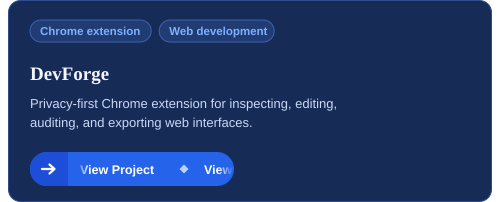
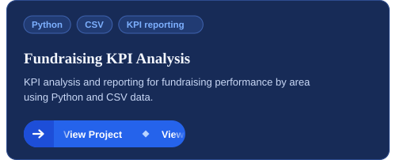
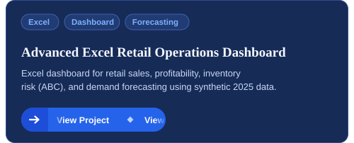
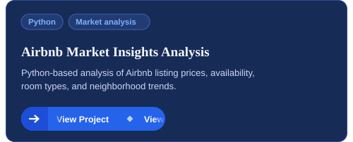
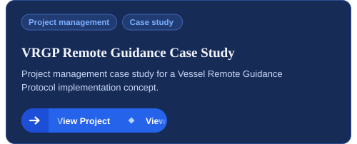
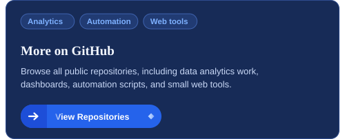

## About

I'm a Data & IT Analyst based in Helsinki, Finland, with an MSc in Governance of Digitalisation from Åbo Akademi University. I turn raw data into clear KPI reporting and use it to improve digital services.

<table width="100%">
  <tr>
    <td width="170" valign="top"><b>Focus</b></td>
    <td>KPI dashboards, Excel/Python analysis, digital service improvement, web development, and data-driven project delivery</td>
  </tr>
  <tr>
    <td width="170" valign="top"><b>Background</b></td>
    <td>IT support and technical problem-solving, campaign performance analysis, and research on digital services and data use</td>
  </tr>
  <tr>
    <td width="170" valign="top"><b>Pinned repositories</b></td>
    <td>Selected work in data analytics, dashboards, automation scripts, and small web tools</td>
  </tr>
</table>

## Skills

## Selected Projects

  
  

  
  

  
  

## Let's Connect

<table width="100%">
  <tr>
    <td width="170" valign="top"><b>LinkedIn</b></td>
    <td><a href="https://www.linkedin.com/in/meshahredoy">linkedin.com/in/meshahredoy</a></td>
  </tr>
  <tr>
    <td width="170" valign="top"><b>Email</b></td>
    <td><a href="mailto:md.hredoy.mesha@gmail.com">md.hredoy.mesha@gmail.com</a></td>
  </tr>
  <tr>
    <td width="170" valign="top"><b>Languages</b></td>
    <td>Bengali, English, Finnish (beginner)</td>
  </tr>
</table>
